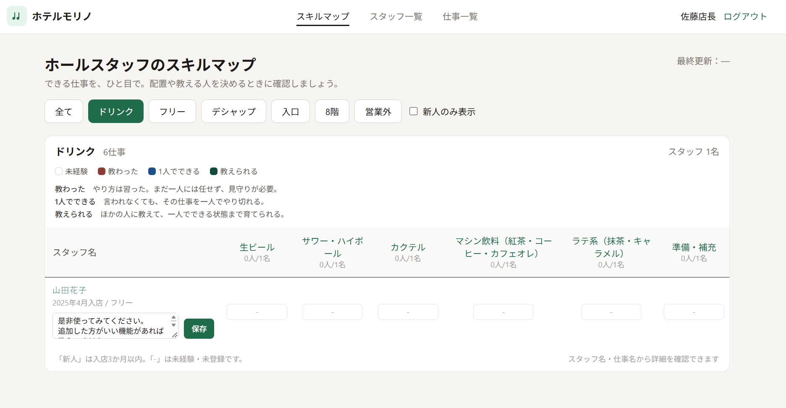

# molino-skill

飲食店ホールスタッフのスキルチェックアプリです。店長がスタッフごと・仕事ごとの習熟度を記録し、スキルマップで一覧できます。



※ 画面のスタッフ名は架空のものです。

## 主な機能

- **スキルマップ**: スタッフ × 仕事の習熟度を表で一覧表示
- **スタッフ管理**: 登録・編集・退職処理。入社から3か月以内のスタッフは「新人」として表示
- **仕事管理**: 仕事の一覧と、その仕事を「できる人」（習熟度2以上・在籍中）の人数
- **習熟度の記録**: 4段階で記録し、変更した日を残す

| 習熟度 | 意味 |
| --- | --- |
| 0 | 未経験 |
| 1 | 教わった |
| 2 | 1人でできる |
| 3 | 教えられる |

## 技術構成

| 領域 | 技術 |
| --- | --- |
| フロントエンド | Next.js 15（App Router）、React 19、Tailwind CSS v4、JavaScript |
| バックエンド（ローカル開発） | Spring Boot 3.5、Spring Security、Spring Data JPA、H2 Database |
| バックエンド（本番） | Next.js の API Route + Vercel Blob |
| 認証 | JWT（Bearer トークン） |
| ホスティング | Vercel |

## アーキテクチャ

ブラウザは Next.js の `/api/*` だけを呼び出します。環境変数 `BLOB_STORE_ID` の有無で処理先が切り替わります。

```
ブラウザ ──> Next.js /api/*（frontend/app/api/[...path]/route.js）
                │
                ├─ BLOB_STORE_ID なし（ローカル）──> Spring Boot（localhost:8080）──> H2
                └─ BLOB_STORE_ID あり（Vercel） ──> frontend/lib/server/data.js ──> Vercel Blob
```

同じAPIを Java と JavaScript の2つで実装しているため、APIや業務ルールを変更するときは両方を修正します。

### なぜ2つのバックエンドがあるのか

- **ローカル（Spring Boot）**: スクールで学んだ Java を実際に動くアプリで使い、controller / service / repository に分けた業務システムの構成を学ぶために実装しています。
- **本番（Vercel）**: Vercel では Spring Boot のような常に起動しているサーバーを動かせません。また、Java を別のサービスで動かすと、無料プランでは停止後の起動待ちやデータ消失の心配があります。そこで、費用をかけずに安定して運用できるよう、本番用は JavaScript と Vercel Blob で実装しました。

修正のたびに両方を直す手間はかかりますが、同じ仕様を2つの言語で実装することで、言語に依存しない設計の考え方を学べています。機能が増えて保守の負担が大きくなった場合は、どちらか一方に統一することを検討します。

## ローカルでの起動方法

### 必要なもの

- Node.js（Next.js 15 が動くバージョン）
- JDK 21（Gradle の実行用。アプリ本体は Java 25 の toolchain でビルドされます）
- Gradle 8.14（Gradle Wrapper は同梱していません）

### 1. バックエンドを起動

```bash
cd backend
gradle bootRun     # http://localhost:8080
```

初回起動時に初期データが作成されます。データは `backend/data/` に保存されます（Git 管理外）。

### 2. フロントエンドを起動

```bash
cd frontend
npm install
npm run dev        # http://localhost:3000
```

### 3. ログイン

ローカル環境のみ、次の開発用アカウントでログインできます。本番環境ではこのパスワードは使えません。

- メール: `sato@example.com`
- パスワード: `password123`

## 環境変数（本番 / Vercel）

| 変数名 | 必須 | 説明 |
| --- | --- | --- |
| `BLOB_STORE_ID` | ○ | Vercel Blob のストアID。設定すると Blob モードで動作 |
| `JWT_SECRET` | ○ | JWT の署名鍵（32文字以上） |
| `MANAGER_PASSWORD` | ○ | 店長アカウントのパスワード（12文字以上） |
| `ALLOWED_EMAILS` | | ログインを許可する追加のメールアドレス（カンマ区切り） |

秘密情報はリポジトリに含めず、Vercel の環境変数で管理しています。

## ディレクトリ構成

```
frontend/
  app/                  各画面（login, skill-map, staffs, tasks）と API の入口
  components/           共通ヘッダー・UI部品
  lib/api.js            クライアント側の API 呼び出し
  lib/server/data.js    本番用 API（Vercel Blob）
backend/src/main/java/jp/molino/skill/
  auth, user            ログイン・ユーザー
  staff, task, skill    機能別の controller / service / repository / entity
  security              JWT の発行と検証
  config                セキュリティ設定・初期データ
```

## 工夫した点

### 実際に使う人の目線で機能を考えた

私はこのレストランでアルバイトとして働いており、まず「現場でどんな能力が求められているか」を自分の経験から洗い出しました。ただ、このアプリを日常的に使うのはスタッフを育成・管理する社員の方です。アルバイトの目線だけでなく、社員の方の目線に立って「どんな情報があれば育成やシフトの判断に役立つか」を考えることを大切にしました。ここがいちばん苦労した点であり、いちばん楽しかった点でもあります。

### 社員の方と認識を合わせながら作った

自分の想像だけで作らないよう、社員の方と連絡を取り合い、必要な機能や使い方について何度もすり合わせました。

最初は「現場ではこういう能力が求められるから、この機能を入れよう」という、アルバイトの視点でしか考えられていませんでした。社員の方と意見を交換するなかで、スタッフを**管理する側**の視点が必要だと気づきました。その結果生まれたのが、スキルマップのスタッフ名の下に書き込めるコメント欄です。習熟度の数字だけでは分からない様子や伝えたいことを、社員の方が残せるようにしました。

### 作って終わりにせず、現場への導入まで進めた

完成後はホテルのレストランの支配人に向けてプレゼンを行い、現場での導入の許可をいただくところまで進めました。

## 今後の課題

### 導入の効果を確かめる

アプリは作って導入することがゴールではなく、スタッフの育成に役立つことが目的です。今後は実際に現場で使ってもらい、このアプリによってスタッフのスキルが本当に上がったのかを確かめていきたいと考えています。たとえば、習熟度が上がるまでの期間や「1人でできる」スタッフの人数の変化を見ることで、効果を確認できると考えています。
